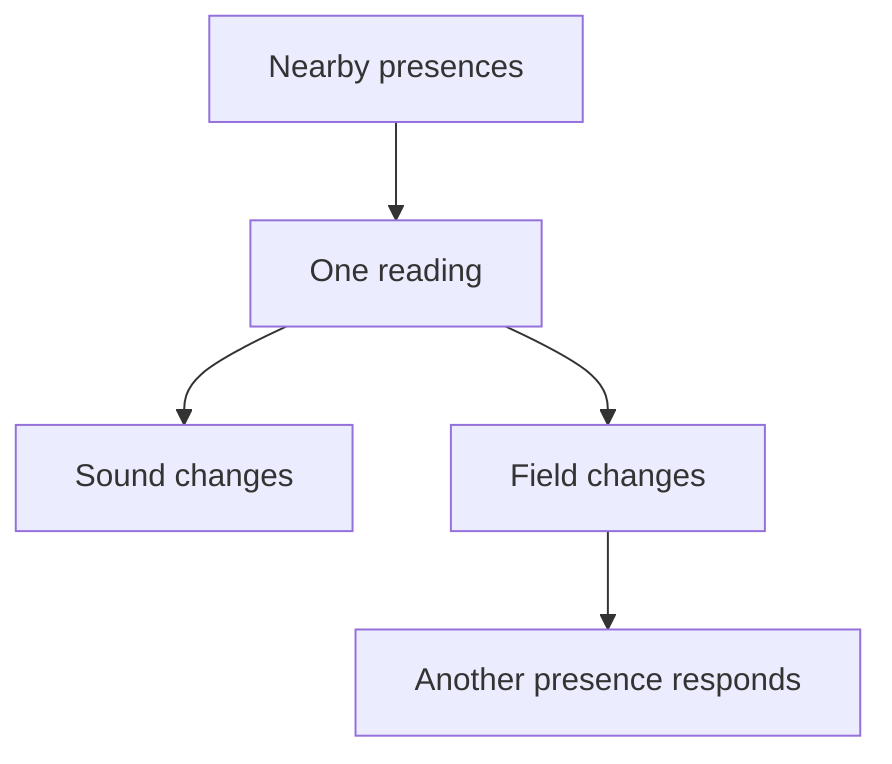
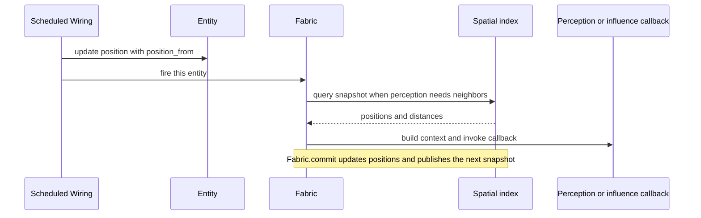
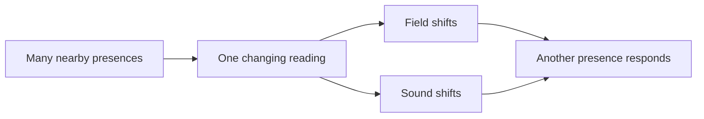
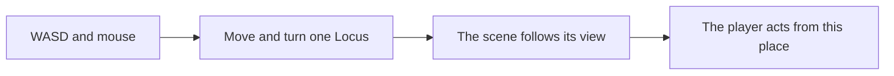
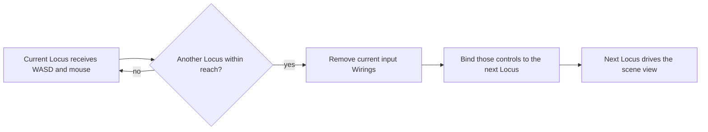

### Introduction

You already know how to make games. You know how to shape space, time, systems, and interaction around what a player can do and notice. This page starts from that experience and follows familiar game-making questions into MayaFlux. Nexus gives you ways to describe presence, perception, influence, and spatial relations. Kinesis and the rest of MayaFlux provide geometry, simulation, sound, state, buffers, processors, and shaders to give those relations form.

### Unlearning

Game tools make some arrangements familiar. A scene contains objects. A player character carries the player's agency. An update loop advances the world. Collision connects bodies. These patterns are useful, but they are not the only way to arrange a game. In MayaFlux, we can describe the relations directly. An Agent or Presence can be a character, but it could also be a location, a moving boundary, or one part of a larger system. Agency can be shared among several presences, or come from the way they affect one another.

### Interactivity is a chain of changes

At its simplest, an interaction has something to encounter, a way to notice it, an action that changes something, and a result the player can notice. The result becomes part of what can happen next. Those parts might all belong to one object, or they might live in different places.

```text
world state -> reading -> response -> changed world state
```

For example, one presence could notice several nearby things. Its reading could change a sound and a field. Another presence could then react to that field. One action has split into several effects, and those effects can lead to more reactions.



This is why it helps to ask what each part can read, what it can change, and where that change goes. The parts might be characters, but they might also be regions, values, buffers, simulations, sounds, or processes.

### Context supplies the current situation

Nexus passes information to a function through a context. The function decides what to do with it. It can return a value for another part of the program to use. A lambda can also capture other values, such as a field or a setting, so its work can combine the context with state from elsewhere.

```cpp
value = read(context);
target(value);
```

That little pattern is the heart of perception and influence. A context is not the interpretation. It is the information available for the interpretation. The function is where you choose what that information means for this work.

### A Sensor reads from its surroundings

A `Sensor` has a position and a query radius. When it fires, Nexus gives it nearby spatial results from the latest published snapshot. Its `PerceptionContext` carries the Sensor's position, radius, and those results. The perception function can use them directly, combine them with captured state, or turn them into another kind of value.

Here, the Sensor turns the number of nearby results into a value and stores it. The example leaves out the Fabric setup and the behavior that uses the count.

```cpp
glm::vec3 position { 0.0F, 0.0F, 0.0F };
auto sensor = std::make_shared<MayaFlux::Nexus::Sensor>(2.0F);
sensor->set_position(position);

float nearby_count = 0.0F;
sensor->set_perception<float>(
    [](const MayaFlux::Nexus::PerceptionContext& ctx) {
        return static_cast<float>(ctx.spatial_results.size());
    },
    [&nearby_count](const float& count) {
        nearby_count = count;
    });
```

The lambda is free to do more than count. It could inspect the distances in `spatial_results`, combine them with a captured threshold, and return a strength value. The target decides what to do with that value. A Sensor gives you one typed perception and target; an Agent can hold several.

### An Emitter sends an influence outward

An `Emitter` starts from an `InfluenceContext`. That context carries the emitter's position, intensity, and radius, along with optional color, size, and cursor position. A producer lambda uses those values to make a result. Its target decides where that result goes.

This example turns position and intensity into a vector. The target stores the result; a real composition could pass it to a field, processor, shader, or another part of the game.

```cpp
auto emitter = std::make_shared<MayaFlux::Nexus::Emitter>();
emitter->set_position(position);
emitter->set_intensity(0.7F);

glm::vec3 influence_value {};
emitter->set_influence<glm::vec3>(
    [](const MayaFlux::Nexus::InfluenceContext& ctx) {
        return ctx.position * ctx.intensity;
    },
    [&influence_value](const glm::vec3& value) {
        influence_value = value;
    });
```

The Sensor and Emitter each provide one typed perception or influence path. Their functions are yours to define, and the values can be ordinary numbers or structured data such as a vector, a shader parameter block, or a Kinesis `Tendency`. Agents can carry several perception and influence paths when one presence needs to read and affect several parts of the work.

### A Sensor follows a path around an object

Now give the Sensor a route around a positioned object. The object and its rendering are ordinary game state here. The Sensor reads the object's current position through captured state. The code below shows the parts handled by Nexus and Kinesis. The object setup and the line that applies the reading to its appearance are left as pseudocode.

Assume `object_position` is the object's live position in the game's state. The Sensor's context supplies its current position, and the lambda compares the two. A spatial `Tendency` turns that offset into a response that gets stronger as the Sensor comes closer. This one uses a simple inverse-square-like curve with a soft floor in the denominator.

```cpp
const MayaFlux::Kinesis::Tendency<glm::vec3, float> distance_response {
    .fn = [](const glm::vec3& offset) {
        const float distance = glm::length(offset);
        return 1.0F / (1.0F + distance * distance);
    }
};

float response = 0.0F;
auto sensor = std::make_shared<MayaFlux::Nexus::Sensor>(3.0F);

sensor->set_perception<float>(
    [&object_position, distance_response](const MayaFlux::Nexus::PerceptionContext& ctx) {
        return distance_response(ctx.position - object_position);
    },
    [&response](const float& value) {
        response = value;
    });
```

The Sensor's position is updated along an orbit by its Fabric wiring. An elliptical path makes the distance vary, so the response changes as it travels.

```cpp
// MayaFlux API excerpt. `fabric` and the object setup are defined elsewhere.
constexpr float orbit_radius = 2.0F;
const glm::vec3 center = object_position;

fabric.wire(sensor)
    .every(1.0 / 60.0, MayaFlux::Vruta::ProcessingToken::FRAME_ACCURATE)
    .position_from([center, orbit_radius, angle = 0.0F]() mutable {
        angle += 0.02F;
        const float radius = orbit_radius * (0.8F + 0.2F * std::sin(angle));
        return center + glm::vec3(
            std::cos(angle) * radius,
            std::sin(angle) * radius * 0.6F,
            0.0F);
    })
    .finalise();
```

The object can use the reading on the next part of its own update:

```text
object.glow = response
object.size = base_size + response * pulse_amount
```

Those assignments are pseudocode because the object and its render state depend on the game being built. The Sensor, its context, the distance Tendency, and Fabric position wiring are MayaFlux API code. The captured `object_position` is the object's current position in the game's state. If the response should depend on several nearby entities, use `ctx.spatial_results` instead and decide how those readings combine.

### A player steers an Emitter through an `MF_FIELD_P`

The player moves an Emitter with the pointer. The Emitter updates a parameter block, and an `MF_FIELD_P` uses that block to color a point cloud on the GPU. `VertexFieldProcessor` runs the field produced by `GpuFieldOperator` over the point records. The fragment shader then reads those vertex colors and draws them.

This route keeps the field in MayaFlux's field system. The field is compiled into the compute shader used by `VertexFieldProcessor`; its output is written into the vertex color attribute. The fragment shader does not run the field itself. It receives the changed color as `in_color` and uses it for the pixel.

The field below colors points according to their distance from the Emitter. `p` is each point's position, `t` is time, and `a` is the parameter block. The Emitter supplies its position in `a.xyz` and strength in `a.w`.

```cpp
namespace MayaFlux::Fields {
using namespace MayaFlux::ShaderCompat;

const auto cursor_color = MF_FIELD_P(cursor_color, [](vec3 p, float t, vec4 a) -> vec3 {
    vec3 cursor = vec3(a.x, a.y, a.z);
    float d = length(p - cursor);
    float near_cursor = clamp(exp(-d * d * 3.0f) * a.w, 0.0f, 1.0f);
    return mix(vec3(0.04f, 0.08f, 0.16f), vec3(1.0f, 0.28f, 0.06f), near_cursor);
});
}
```

`vega.evolve` sets up a compatible point network, binds the field to the vertex color, and attaches the GPU field pass and rendering. After that setup, the network's `GpuFieldOperator` can be reached and given new parameters.

```cpp
auto points = vega.ParticleNetwork(
    4000,
    glm::vec3(-1.0F),
    glm::vec3(1.0F),
    MayaFlux::Kinesis::SpatialDistribution::RANDOM_SPHERE);

vega.evolve(
    points,
    {},
    [](const auto& field) {
        field->bind(MayaFlux::Nodes::Network::FieldTarget::COLOR, MayaFlux::Fields::cursor_color);
    },
    { .target_window = window });

auto gpu_field = points->get_operator_chain()->find<MayaFlux::Nodes::Network::GpuFieldOperator>();
```

The Emitter returns the parameter block, and `bind_params` passes it to the GPU field operator. The pointer handler updates the Emitter position with the real setter:

```cpp
// In the pointer callback. The coordinate conversion is game-specific.
emitter->set_position(pointer_to_world(pointer));
emitter->set_intensity(pointer_strength);
```

The Emitter runs once per frame and supplies fresh parameters to the next field dispatch.

```cpp
auto emitter = std::make_shared<MayaFlux::Nexus::Emitter>();

emitter->set_influence<glm::vec4>(
    [](const MayaFlux::Nexus::InfluenceContext& ctx) {
        return glm::vec4(ctx.position, ctx.intensity);
    },
    MayaFlux::Nexus::bind_params(gpu_field));

fabric.wire(emitter)
    .every(1.0 / 60.0, MayaFlux::Vruta::ProcessingToken::FRAME_ACCURATE)
    .finalise();
```

```text
on_pointer_move(pointer):
    emitter.position = pointer_to_world(pointer)

on_fabric_commit:
    emitter produces vec4(position, intensity)
    GpuFieldOperator stores the field parameters

on_graphics_processing:
    VertexFieldProcessor runs cursor_color for each point
    the field writes each point's color
    point.frag reads in_color and draws the point
```

The pointer conversion and setup of the world object remain pseudocode. The field, field binding, Emitter producer, parameter target, and Fabric cadence use the v0.5.0 APIs. The important path is direct: input moves the Emitter, Nexus passes its context to the producer, the producer updates `GpuFieldOperator`, and `VertexFieldProcessor` applies the field before rendering. `point.frag` then reads the result as vertex color.

There are other field consumers too. `ComputeMeshBuffer` can evaluate an `MF_FIELD`, `MF_FIELD_T`, or `MF_FIELD_P` directly to build a surface from a scalar field. Start with `VertexFieldProcessor` here because its path from a live Emitter parameter to a visible color change is short and easy to follow.

### Fabric and Wiring

We have already used `Fabric` and `Wiring` in the examples. Here is what they are doing. A `Fabric` registers Nexus entities and keeps their positions in a spatial index. `fabric.wire(entity)` registers an entity and gives you a `Wiring` builder. The builder says when that entity should fire and, optionally, how its position should change. Calling `finalise()` applies those choices.

```cpp
fabric.wire(object).finalise();

fabric.wire(sensor)
    .every(1.0 / 60.0, MayaFlux::Vruta::ProcessingToken::FRAME_ACCURATE)
    .position_from(next_sensor_position)
    .finalise();
```

The first line registers a positioned object that can be found by spatial queries. The second registers a Sensor that gets a new position on each tick. `position_from` is evaluated by `every`; Nexus sets the returned position and then fires the Sensor.

`Fabric::commit()` refreshes the shared spatial picture. It updates indexed positions, publishes a snapshot, checks registered Expanses, and fires registrations left in commit-driven mode. A scheduled or event-driven Wiring fires its own entity against the latest snapshot. That firing does not publish a new snapshot for all the other entities.



If several moving entities need to sense one another at their current positions, arrange for a commit after their positions have been updated. A simple frame schedule can make that explicit:

```cpp
schedule_metro(
    1.0 / 60.0,
    [&fabric] { fabric.commit(); },
    "publish_world_positions",
    MayaFlux::Vruta::ProcessingToken::FRAME_ACCURATE);
```

The order matters when the behavior reads `ctx.spatial_results`. The orbiting Sensor above compares its context position with a captured object position, so it does not need to look the object up in the spatial results. A Sensor that reacts to all nearby entities reads the snapshot published by `commit()`.

Wiring also supports event triggers and authored movement. These examples show three different ways to fire an Emitter or Presence:

```cpp
// Once when Space is pressed.
fabric.wire(emitter)
    .on(window, MayaFlux::IO::Keys::Space)
    .finalise();

// On pointer motion while the left button is held.
fabric.wire(pointer_emitter)
    .on(window, MayaFlux::IO::MouseButtons::Left, true)
    .finalise();

// Visit two positions, pause before the second, and repeat the route.
fabric.wire(moving_presence)
    .move_to(first_position)
    .move_to(second_position, 0.3)
    .times(2)
    .finalise();
```

On a mouse event, the Emitter receives the pointer coordinates in `InfluenceContext::cursor_pos`. That is separate from its world position. The input code decides how to convert the pointer and can call `emitter->set_position(...)` when the influence itself should move. `move_to` instead gives the entity a sequence of positions, firing it at each step. For a custom coroutine, `use()` lets you decide when to call `Fabric::fire()` yourself.

The main idea is simple: `Fabric` keeps the spatial picture; `Wiring` decides when one entity acts. A Sensor can run on a timer, an Emitter can answer an input event, or a Presence can follow a short route. Their callbacks decide what each firing means and where its result goes.

### One presence, several directions of action

A Sensor can hold one clear act of attention. An Emitter can hold one clear act of influence. Either one may contain a complicated rule. The point is that each remains one thing we can name and follow: this is what notices; this is what acts. That kind of unity gives us a useful handle on a behavior without deciding in advance how simple the behavior must be.

Now picture a presence moving through a space. It does not need to be a person, or even a thing the player can see. As it moves, it takes in several nearby presences. Their distances and relations contribute to a changing reading. That reading might bend a field, alter a sound, and change how another presence responds. The motion, the reading, and the consequences belong to one continuing presence, even as its effects travel elsewhere.



This is the step from a Sensor or Emitter to an Agent. The Agent can carry both perception and influence under one identity. It can move, read a neighborhood, and act on the reading. If the behavior grows, it can hold more than one perception and more than one influence. Each can have its own targets, so a reading or response can branch without turning the Agent into a pile of unrelated objects.

The contexts mark the two directions of this exchange. `PerceptionContext` is the situation arriving from the surrounding space. `InfluenceContext` is the situation from which the Agent acts, including its current position and influence values. The functions decide what these mean here. They can also bring in state from elsewhere, so the Agent's action can depend on what it has noticed before.

```cpp
auto agent = std::make_shared<MayaFlux::Nexus::Agent>(3.0F);
agent->set_position(agent_position);

float neighborhood = 0.0F;
auto reading = agent->add_perception<float>(
    [&agent](const MayaFlux::Nexus::PerceptionContext& ctx) {
        float sum = 0.0F;
        for (const auto& result : ctx.spatial_results) {
            if (result.id != agent->id()) {
                sum += 1.0F / (1.0F + result.distance_sq);
            }
        }
        return sum;
    });
reading->add_target([&neighborhood](const float& value) {
    neighborhood = value;
});

auto response = agent->add_influence<glm::vec4>(
    [&neighborhood](const MayaFlux::Nexus::InfluenceContext& ctx) {
        return glm::vec4(ctx.position, neighborhood);
    });
response->add_target(MayaFlux::Nexus::bind_params(gpu_field));

fabric.wire(agent)
    .every(1.0 / 60.0, MayaFlux::Vruta::ProcessingToken::FRAME_ACCURATE)
    .position_from(next_agent_position)
    .finalise();
```

On each firing, the Agent's moving position gives the reading a point of view. The nearby results become a single measure of the surrounding activity. The influence carries that measure onward with the Agent's position, where the field can use it. The same reading could also feed a sound, or another influence could respond to a different part of the neighborhood. The code is short because the relationships are the subject; the game decides what those changes look and sound like.

`Presence` and `Locus` take this idea further in different directions. A Presence gathers its neighbors and radiates a distance-weighted influence to each one. A Locus carries a moving viewpoint and can send it to several render processors. They are children of Agent, with particular forms of agency already built in. Sensor and Emitter remain useful when one coherent operation is what the game calls for. Agent is for when one presence needs to notice and affect the world in several connected ways.

### Two ways to give the player control

Keep the same space, the same Loci, and the same relations. Change what movement means to the player.

In the first version, one Locus receives the controls. WASD moves its viewpoint, the mouse turns it, and a click changes its intensity. The player's hand stays close to the action: press, move, arrive. The Locus already connects movement to perception and view, so its viewpoint travels with it.

WASD and mouse are familiar industry conventions, but their meaning is still a choice. A key's lambda can branch on something a Sensor has read, change several related things, or send a response through a field. Here it moves the Locus. Control could also begin with a microphone level, a carefully made web of relations, or a rhythm or time pattern. The keyboard is one source among many; it does not decide what agency has to look like.



The visible setup is just the binding call:

```cpp
PlayerControls controls = bind_locus_controls(fabric, window, current_locus);
```

<details>
<summary>Show the key binding and Locus construction</summary>

The key-binding lambda gives each held key one flag. The Locus advances those flags on its frame Wiring. Mouse movement updates the same navigation state; the Locus sends its resulting view to the render processors.

```cpp
#include "MayaFlux/MayaFlux.hpp"
#include "MayaFlux/Nexus/Principals/Locus.hpp"

struct PlayerControls {
    std::vector<uint32_t> wiring_ids;
    std::vector<std::function<void()>> reset;
};

PlayerControls bind_locus_controls(
    MayaFlux::Nexus::Fabric& fabric,
    const std::shared_ptr<MayaFlux::Core::Window>& window,
    const std::shared_ptr<MayaFlux::Nexus::Locus>& locus)
{
    using namespace MayaFlux;

    PlayerControls controls;
    auto& nav = locus->nav();

    const auto bind_key = [&](IO::Keys key, bool& movement_flag) {
        bool* held = &movement_flag;
        auto emitter = std::make_shared<Nexus::Emitter>(
            [held](const Nexus::InfluenceContext&) { *held = true; });

        auto wiring = fabric.wire(emitter);
        controls.wiring_ids.push_back(wiring.entity_id());
        controls.reset.push_back([held]() { *held = false; });
        wiring.on(window, key, true, [held]() { *held = false; }).finalise();
    };

    bind_key(IO::Keys::W, nav.forward_held);
    bind_key(IO::Keys::A, nav.left_held);
    bind_key(IO::Keys::S, nav.back_held);
    bind_key(IO::Keys::D, nav.right_held);

    auto look = std::make_shared<Nexus::Emitter>(
        [locus](const Nexus::InfluenceContext& ctx) {
            if (!ctx.cursor_pos)
                return;

            auto& nav = locus->nav();
            if (nav.first_mouse) {
                nav.last_x = ctx.cursor_pos->x;
                nav.last_y = ctx.cursor_pos->y;
                nav.first_mouse = false;
                return;
            }

            Kinesis::apply_mouse_delta(
                nav,
                static_cast<float>(ctx.cursor_pos->x - nav.last_x),
                static_cast<float>(ctx.cursor_pos->y - nav.last_y));
            nav.last_x = ctx.cursor_pos->x;
            nav.last_y = ctx.cursor_pos->y;
        });

    auto mouse_wiring = fabric.wire(look);
    controls.wiring_ids.push_back(mouse_wiring.entity_id());
    controls.reset.push_back([locus]() { locus->nav().first_mouse = true; });
    mouse_wiring
        .on(window, IO::MouseButtons::Right, true,
            [locus](double, double) { locus->nav().first_mouse = true; })
        .finalise();

    auto click = std::make_shared<Nexus::Emitter>(
        [locus](const Nexus::InfluenceContext&) {
            locus->set_intensity(locus->intensity() > 0.5F ? 0.25F : 1.0F);
        });
    auto click_wiring = fabric.wire(click);
    controls.wiring_ids.push_back(click_wiring.entity_id());
    click_wiring.on(window, IO::MouseButtons::Left).finalise();

    return controls;
}

void unbind_locus_controls(
    MayaFlux::Nexus::Fabric& fabric,
    const PlayerControls& controls)
{
    for (const uint32_t id : controls.wiring_ids)
        fabric.remove(id);
    for (const auto& reset : controls.reset)
        reset();
}

std::shared_ptr<MayaFlux::Nexus::Locus> make_locus(
    MayaFlux::Nexus::Fabric& fabric,
    const glm::vec3& eye,
    const std::shared_ptr<MayaFlux::Buffers::VKBuffer>& buffer,
    float aspect)
{
    MayaFlux::Kinesis::NavigationConfig config {
        .initial_eye = eye,
        .initial_target = eye + glm::vec3(0.0F, 0.0F, -1.0F),
        .move_speed = 2.0F,
    };

    auto locus = std::make_shared<MayaFlux::Nexus::Locus>(
        config,
        2.0F,
        MayaFlux::Nexus::Agent::PerceptionFn {},
        MayaFlux::Nexus::Agent::InfluenceFn {});
    locus->set_aspect(aspect);
    locus->attach(buffer, {
        .on_move = MayaFlux::Nexus::AttachConfig::OnMove::Carry,
    });

    fabric.wire(locus)
        .every(1.0 / 60.0, MayaFlux::Vruta::ProcessingToken::FRAME_ACCURATE)
        .finalise();
    return locus;
}

// current_buffer is already rendered. These are the render processors
// whose view should follow the controlled Locus.
auto current_locus = make_locus(fabric, current_eye, current_buffer, aspect);
for (const auto& processor : scene_processors)
    current_locus->add_view_target(processor);
```

</details>

The second version changes the meaning of movement. There is no single viewpoint that the player carries through the whole space. Each place has its own Locus and attached buffer. When the controlled Locus comes close to another one, the controls move across. The player stops steering the first place and begins acting from the next.



Create the next Locus with the same helper. Both remain in Fabric; only the current one drives the scene processors. The proximity check removes the old bindings, moves the view targets, and binds the controls to the next Locus. This is where control changes meaning, so the handoff stays in the main example.

```cpp
auto next_locus = make_locus(fabric, next_eye, next_buffer, aspect);

struct ControlHandoff {
    std::shared_ptr<MayaFlux::Nexus::Locus> current;
    std::shared_ptr<MayaFlux::Nexus::Locus> next;
    PlayerControls controls;
    bool transferred {};
};

const float handoff_distance = 1.25F;
auto handoff = std::make_shared<ControlHandoff>(ControlHandoff {
    .current = current_locus,
    .next = next_locus,
    .controls = std::move(controls),
});

auto proximity = std::make_shared<MayaFlux::Nexus::Emitter>(
    [&fabric, window, scene_processors, handoff, handoff_distance](const MayaFlux::Nexus::InfluenceContext&) {
        if (handoff->transferred
            || !handoff->current->position()
            || !handoff->next->position())
            return;

        if (glm::distance(*handoff->current->position(), *handoff->next->position())
            >= handoff_distance)
            return;

        unbind_locus_controls(fabric, handoff->controls);
        for (const auto& processor : scene_processors) {
            handoff->current->remove_view_target(processor);
            handoff->next->add_view_target(processor);
        }
        handoff->controls = bind_locus_controls(fabric, window, handoff->next);
        handoff->current = handoff->next;
        handoff->transferred = true;
    });

fabric.wire(proximity)
    .every(1.0 / 60.0, MayaFlux::Vruta::ProcessingToken::FRAME_ACCURATE)
    .finalise();
```

The first version gives direct, tactile control over one Locus. In the second, movement only carries control as far as another Locus. Proximity decides when the player's actions begin coming from that new viewpoint. The same movement and view machinery serves both arrangements. What changes is the relation between the player's movement and the place from which they act.
